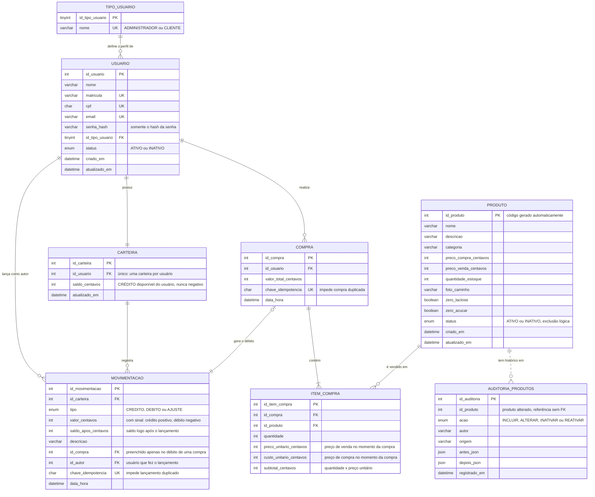
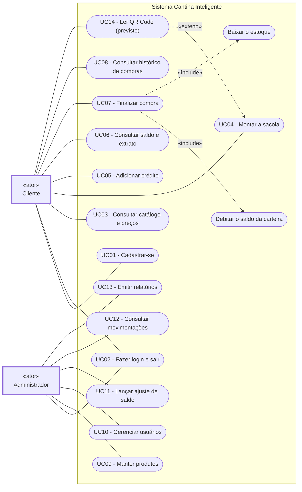
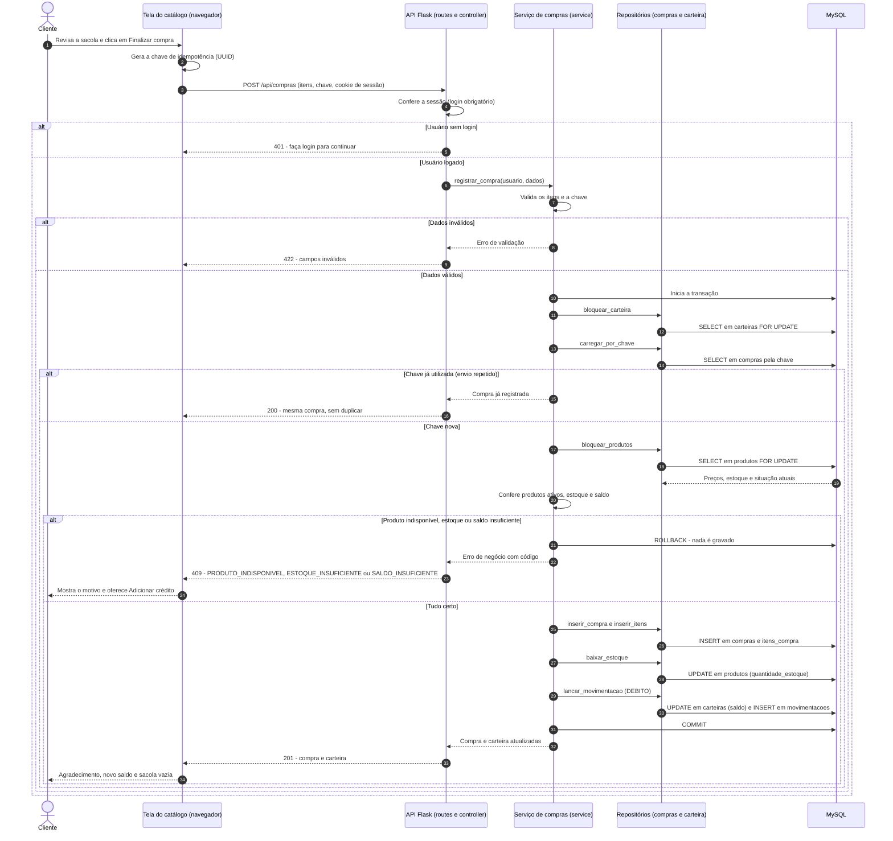
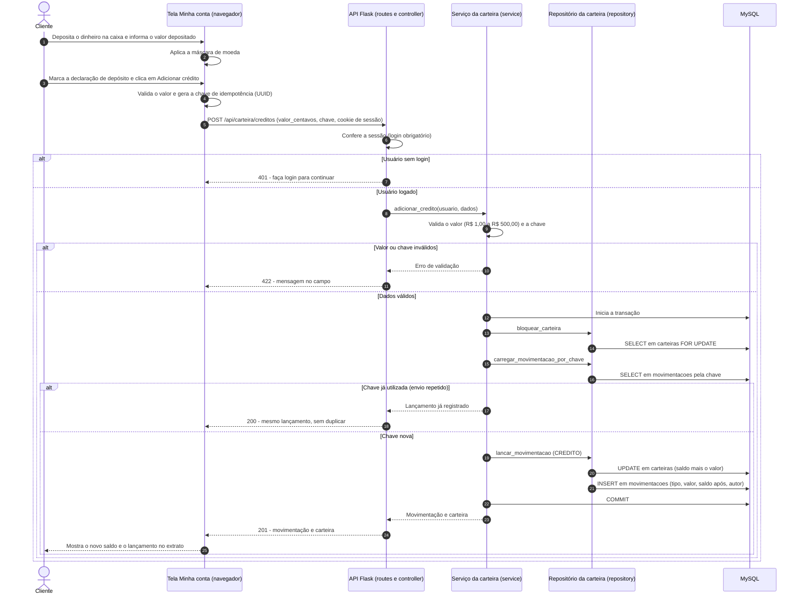
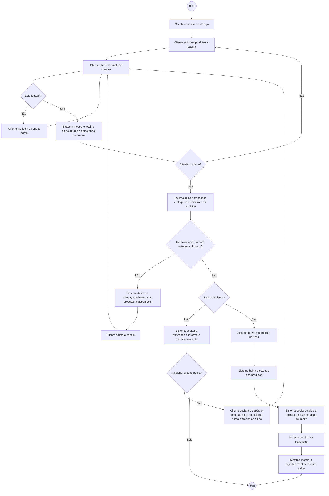
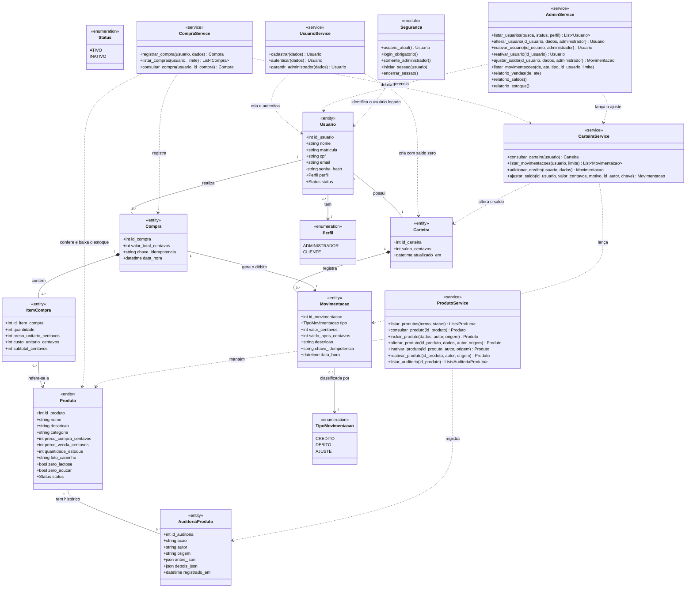
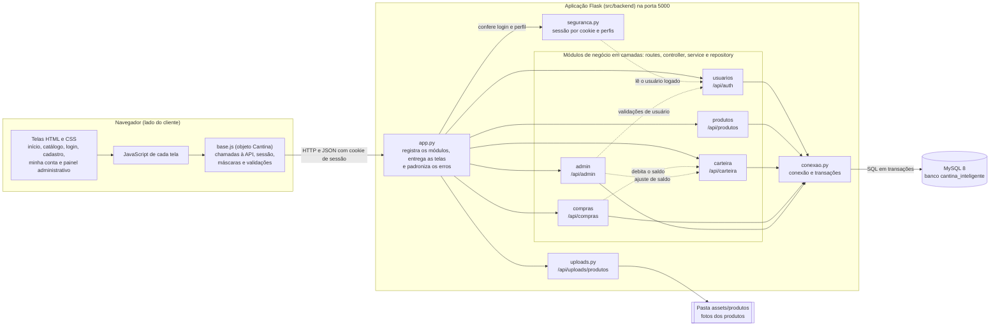
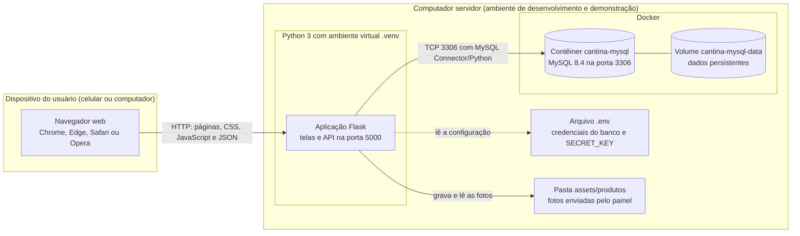
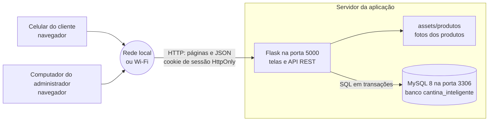

# Documento do Sistema — Cantina Inteligente

> **Como usar este arquivo** (apague este bloco antes de gerar o PDF)
>
> 1. **Copiar para o template.** Este é o texto final do Documento do Sistema, na mesma ordem e numeração do template da professora. Copie seção por seção para o Google Docs/Word do grupo, mantendo a formatação do template (capa, tabelas e fontes).
> 2. **Diagramas.** Cada bloco `mermaid` deste arquivo tem um arquivo igual em [`docs/diagramas/`](diagramas/README.md). Exporte cada um para PNG (pelo site mermaid.live ou pelo comando do README daquela pasta) e cole como imagem, com a legenda `Imagem N: ...` e a fonte `Fonte: Elaborado pela equipe do Projeto Aplicado II (2026).`
> 3. **Itens a confirmar.** Procure por `[CONFIRMAR` e resolva cada um antes de exportar o PDF. São eles:
>    - Histórico de Versões: datas, autores e revisores das versões 1.9 a 2.2 (estão como "Equipe 4").
>    - 3.1: nome da coordenação do curso (o nome veio da versão de agosto).
>    - RF13 (QR Code): dizer se foi implementado ou se fica como evolução.
>    - RNF04 (backup), RNF05 (desempenho) e RNF12 (acessibilidade, requisito novo sugerido).
>    - 7.4: conferir os nomes das operações com o código final.
>    - 7.6 e 8.1: dizer se o sistema foi publicado online ou se roda só no ambiente local.
>    - 9.1: confirmar o GitHub Projects no lugar do Trello e o acesso da professora ao quadro.
>    - 9.2: confirmar que o repositório está com acesso liberado.
> 4. **Revisão.** Dois integrantes devem ler o PDF final conferindo com o sistema rodando: nenhuma seção vazia e nada descrito que o sistema não faça.
> 5. **Correções da professora.** A tabela "Correções aplicadas nesta versão", no fim deste arquivo, mostra onde cada correção pedida foi atendida. Ela é um apoio para o grupo e para a apresentação; não faz parte do template.

---

## Capa

Dados da capa, na ordem em que aparecem no template (manter o logotipo do SENAI do template):

| Campo | Conteúdo |
| --- | --- |
| Instituição | CENTRO UNIVERSITÁRIO SENAI SANTA CATARINA |
| Unidade curricular | UNIDADE CURRICULAR: PROJETO APLICADO II |
| Professor | PROFESSOR: JANICE DETERS |
| Curso | Curso Superior de Tecnologia em Análise e Desenvolvimento de Sistemas |
| Título | DOCUMENTO DO SISTEMA: CANTINA INTELIGENTE |
| Equipe | EQUIPE 4 |
| Integrantes | ANA CECÍLIA PEREIRA LACERDA COSTA EDUARDO PEIXOTO DOS PASSOS DA SILVA LUAN LIMA DE SOUZA PABLO SANTOS VANESSA KATHLEEN GÓES LEITE |
| Local | Florianópolis/SC |

---

## Histórico de Versões

| Data | Versão | Descrição | Autor | Revisor |
| --- | --- | --- | --- | --- |
| 06/08/2026 | 1.0 | Elaboração inicial do documento. | Vanessa Leite | |
| 07/08/2026 | 1.1 | Preenchimento da seção de descrição da solução. | Vanessa Leite | |
| 12/08/2026 | 1.2 | Preenchimento da seção de atores. | Luan Lima de Souza | |
| 14/08/2026 | 1.3 | Preenchimento das seções Escopo e Planejamento do Projeto Aplicado. | Eduardo Peixoto | Luan Souza, Ana Cecília P. Costa |
| 16/08/2026 | 1.4 | Finalização, formatação e geração de PDF. | Eduardo Peixoto, Vanessa Leite | Ana Cecília P. Costa, Vanessa Leite, Eduardo Peixoto |
| 28/08/2026 | 1.5 | Mapeamento das partes interessadas e dos atores. | Luan Lima de Souza | Vanessa Leite |
| 29/08/2026 | 1.6 | Preenchimento da seção 5.1 Requisitos funcionais. Preenchimento da seção 5.2 Requisitos não funcionais. | Vanessa Leite, Eduardo Peixoto | |
| 29/08/2026 | 1.7 | Conclusão do preenchimento da seção 5.2 Requisitos não funcionais. | Ana Cecília P. Costa | Eduardo Peixoto |
| 20/09/2026 | 1.8 | Preenchimento da seção 6. Diagrama de Modelo Entidade e Relacionamento. | Eduardo Peixoto, Ana Cecília, Luan Lima, Vanessa Leite | Eduardo Peixoto, Ana Cecília, Vanessa Leite, Luan Lima |
| 17/11/2026 | 1.9 | Correções das devolutivas: Partes Interessadas no formato do template; atores Cliente e Administrador; requisitos funcionais reescritos (inclusão do crédito, unificação dos antigos RF06 e RF12, exclusão dos antigos RF04 e RF10, retirada da validade); requisitos não funcionais renumerados; nova seção 5.3 Regras de Negócio. | Equipe 4 | **[CONFIRMAR: revisor]** |
| 17/11/2026 | 2.0 | Atualização da Descrição da Solução (carteira de créditos, compra com débito e relatórios) e novo Modelo Entidade-Relacionamento, com o crédito explícito. | Equipe 4 | **[CONFIRMAR: revisor]** |
| 17/11/2026 | 2.1 | Preenchimento da seção 7 (diagramas UML), da seção 8 (Proposta de Solução Tecnológica e Topologia) e da seção 9 (planejamento e repositório). | Equipe 4 | **[CONFIRMAR: revisor]** |
| **[CONFIRMAR: data]** | 2.2 | Revisão final, conferência com o sistema implementado e geração do PDF. | Equipe 4 | **[CONFIRMAR: revisor]** |

**[CONFIRMAR: nas linhas 1.9 a 2.2, trocar "Equipe 4" pelos nomes de quem escreveu e revisou cada parte e ajustar as datas.]**

## Objetivos de cada projeto aplicado

- **Projeto Aplicado I** – protótipo da solução
- **Projeto Aplicado II** – aplicação integrando com banco de dados
- **Projeto Aplicado III** – aplicação CLIENTE/SERVIDOR (web)
- **Projeto Aplicado IV** – aplicação CLIENTE/SERVIDOR ou mobile (web e mobile) com testes unitários

## 1. Escopo

A Unidade SENAI Fraiburgo possui uma Cantina da Honestidade, que funciona sem atendimento presencial: cada usuário é responsável por retirar os produtos disponíveis e realizar o pagamento espontaneamente em uma caixa destinada para esse fim. Entretanto, têm sido observadas situações em que produtos são retirados sem o respectivo pagamento, além da inexistência de um sistema que permita controlar usuários, créditos, compras e movimentações financeiras.

Atualmente, todo o processo é baseado exclusivamente na confiança dos usuários, utilizando apenas uma caixa física para depósito do dinheiro. Esse modelo dificulta o controle das vendas e impossibilita identificar quais produtos foram adquiridos, quem realizou a compra e qual o valor arrecadado.

**Link do SAGA SENAI:** https://plataforma.gpinovacao.senai.br/plataforma/demandas-da-industria/interna/12855?page=1.

**O que o sistema cobre nesta entrega (Projeto Aplicado II):**

- cadastro de usuários e login com matrícula, e-mail ou CPF;
- cadastro de produtos e consulta dos preços em um catálogo;
- carteira virtual: adição de créditos e consulta do saldo;
- registro das compras com desconto automático do saldo e baixa do estoque;
- histórico de compras e extrato da carteira;
- painel administrativo para gerenciar usuários, produtos e movimentações financeiras;
- relatórios de vendas, saldos, estoque e depósitos declarados.

**Restrições da demanda consideradas:** não descaracterizar a Cantina da Honestidade; não permitir acesso não autorizado; não gerar inconsistência entre compras e saldos; ter baixo custo; permitir expansões futuras sem reconstruir o sistema.

**Fora do escopo desta entrega:** pagamento eletrônico (Pix ou cartão), aplicativo mobile instalável, cadastro de fornecedores, controle de validade dos produtos e perfil de repositor. Esses itens ficam registrados como possibilidades de evolução.

## 2. Descrição da Solução

A solução é a **Cantina Inteligente**, uma aplicação web acessada pelo navegador do celular ou do computador, sem instalação. Ela mantém o funcionamento da Cantina da Honestidade: não há atendente e ninguém libera os produtos. O que muda é que cada usuário passa a ter um cadastro e uma **carteira virtual de créditos**, e cada retirada de produto fica registrada.

O funcionamento é este:

1. **Cadastro e login.** O usuário cria a própria conta com nome, matrícula, CPF, e-mail e senha, e entra no sistema com a matrícula, o e-mail ou o CPF.
2. **Crédito.** O usuário deposita o dinheiro na caixa da cantina, como já faz hoje, e declara no sistema o valor depositado. Esse valor entra como crédito na sua carteira.
3. **Compra.** O usuário consulta o catálogo com os preços, coloca os produtos na sacola e finaliza a compra. O sistema confere o estoque e o saldo, registra a compra, baixa o estoque e desconta o total do saldo automaticamente, em uma única operação. Se o saldo não for suficiente, a compra é bloqueada e o sistema oferece a opção de adicionar crédito.
4. **Acompanhamento.** O usuário consulta o saldo, o extrato da carteira (créditos, débitos e ajustes) e o histórico das suas compras.
5. **Administração.** O administrador mantém os produtos (preço de compra, preço de venda e estoque), gerencia os usuários, consulta as movimentações financeiras e emite relatórios de vendas, saldos, estoque e depósitos declarados. Com o total dos depósitos declarados, ele confere o dinheiro da caixa e, se encontrar diferença, lança um ajuste de saldo com o motivo.

A solução prioriza a facilidade de uso, a simplicidade e a confiabilidade das informações, mantendo os princípios da Cantina da Honestidade e utilizando recursos tecnológicos de baixo custo.

**Descrição do Problema:**

O valor arrecadado fica em uma caixa específica, mas não há controle sobre o que foi vendido, para quem, por quanto ou se houve pagamento, além de impossibilitar troco ao pagador. Esse conjunto de fatores dificulta a administração da Cantina e chama atenção para a necessidade de uma alternativa que organize o processo com maior segurança e garanta o cumprimento de cada etapa da venda para todas as partes.

Com a carteira de créditos, a falta de troco deixa de ser um problema: o valor depositado a mais continua como saldo para as próximas compras.

**Impacto:** O SENAI Fraiburgo (SC) e os clientes da cantina.

**Justificativa:** Necessidade do SENAI Fraiburgo de gerenciar a Cantina da Honestidade com maior controle e segurança.

## 3. Partes Interessadas

### 3.1 Coordenação do Curso de Análise de Sistemas

Aline Antoneli. **[CONFIRMAR: nome da coordenação — é o que consta na versão de agosto do documento.]**

### 3.2 Professor da UC Projeto Aplicado II

Janice Deters.

### 3.3 Cliente da aplicação

SENAI Fraiburgo (SC).

## 4. Atores

| Ator | Descrição |
| --- | --- |
| Cliente | Usuário da Cantina da Honestidade com matrícula na unidade. Cria a própria conta, faz login, consulta o catálogo e os preços, adiciona créditos declarando o depósito feito na caixa, consulta o saldo e o extrato, registra as suas compras e consulta o histórico. |
| Administrador | Responsável pela cantina. Acessa o painel administrativo para manter os produtos (preços e estoque), gerenciar os usuários, lançar ajustes de saldo, consultar as movimentações financeiras e emitir os relatórios de vendas, saldos, estoque e depósitos declarados. |

Todo usuário que se cadastra pelo sistema recebe o perfil Cliente. O primeiro Administrador é criado por um comando de instalação; depois disso, um administrador pode alterar o perfil de outros usuários.

**Evolução futura.** Dois atores previstos nas versões anteriores deste documento ficam fora desta entrega e permanecem como evolução:

- **Repositor:** perfil que registraria entradas de mercadoria e contagens de estoque, sem acesso à parte financeira. Hoje a reposição é feita pelo Administrador, alterando a quantidade em estoque no cadastro do produto.
- **Gateway Pix:** sistema externo que confirmaria pagamentos eletrônicos e geraria o crédito automaticamente. Hoje o crédito vem do depósito na caixa, declarado pelo próprio usuário.

## 5. Requisitos

### 5.1 Requisitos Funcionais

| Requisito |
| --- |
| **RF01:** O sistema deve permitir que o usuário crie o próprio cadastro informando nome, matrícula, CPF, e-mail e senha, validando os dados e recusando matrícula, CPF ou e-mail já cadastrados. |
| **RF02:** O sistema deve permitir que o usuário cadastrado faça login informando matrícula, e-mail ou CPF e a senha, e que encerre a sessão quando desejar. |
| **RF03:** O sistema deve permitir ao administrador cadastrar, consultar, alterar, inativar e reativar os produtos da Cantina da Honestidade. O código do produto é gerado automaticamente e o cadastro registra nome, categoria, descrição, foto, preço de compra, preço de venda e quantidade em estoque. A exclusão é lógica: o produto fica inativo e permanece no banco de dados. |
| **RF04:** O sistema deve listar para os clientes os produtos ativos da cantina (catálogo), informando nome, preço de venda, foto, disponibilidade em estoque e, quando aplicável, os selos de zero lactose e zero açúcar. |
| **RF05:** O sistema deve permitir que o cliente adicione produtos disponíveis a uma sacola de compras, altere as quantidades e remova itens antes de finalizar a compra, informando o valor total dos produtos selecionados. |
| **RF06:** O sistema deve manter, para cada usuário, um crédito em carteira virtual e permitir que o usuário adicione créditos declarando o valor que depositou na caixa da cantina. |
| **RF07:** O sistema deve permitir que o usuário consulte o saldo de créditos e o extrato das movimentações da sua carteira (créditos, débitos e ajustes). |
| **RF08:** O sistema deve permitir que o cliente logado finalize e registre a compra dos produtos da sacola, abatendo automaticamente do seu saldo de créditos o valor total da compra, e deve apresentar uma mensagem de agradecimento ao final. |
| **RF09:** O sistema deve atualizar a quantidade disponível em estoque após o registro da compra, considerando os produtos comprados como retirados. |
| **RF10:** O sistema deve permitir que o usuário consulte o histórico das suas compras, com data e hora, produtos, quantidades, preços e valor total. |
| **RF11:** O sistema deve permitir ao administrador gerenciar os usuários (consultar, alterar os dados, alterar o perfil, inativar e reativar), lançar ajustes de saldo com motivo e consultar as movimentações financeiras com filtros por período, tipo e usuário. |
| **RF12:** O sistema deve permitir ao administrador consultar relatórios de vendas por período (total vendido, quantidade de compras, vendas por produto e por dia), de saldos dos usuários, de estoque (quantidades, valor em estoque e produtos sem estoque) e de depósitos declarados no período, para conferência com a caixa. |
| **RF13:** O sistema deve disponibilizar QR Code para facilitar o registro da compra: um QR Code da cantina, que abre o catálogo, e um QR Code por produto, que adiciona o item à sacola. **[CONFIRMAR se foi implementado. Se não foi, manter o requisito e escrever: "Previsto como evolução; não faz parte desta entrega."]** |

**Correspondência com a demanda e com a versão anterior deste documento**

| Requisito | Item da demanda | Versão anterior |
| --- | --- | --- |
| RF01 | Cadastro de usuários | Novo. O antigo RF01 tratava apenas do perfil de administrador e passou a fazer parte do RF11. |
| RF02 | Login com matrícula, e-mail ou CPF | Novo. |
| RF03 | Cadastro de produtos | Antigo RF02, com código automático, preço de compra e de venda e exclusão lógica. |
| RF04 | Consulta dos preços | Antigo RF03, **sem a data de validade**. |
| RF05 | Apoio ao registro das compras | Antigo RF05. |
| RF06 | Adição de créditos | **Novo: requisito de crédito pedido na devolutiva.** |
| RF07 | Consulta do saldo | Novo. |
| RF08 | Registro das compras e desconto automático do saldo | **Antigos RF06 e RF12 unificados.** Inclui o agradecimento do antigo RF13. O valor pago deixa de ser livre: é o total dos produtos. |
| RF09 | Desconto automático (estoque) | Antigo RF09. |
| RF10 | Histórico de compras | Novo. |
| RF11 | Painel administrativo: usuários e movimentações | Antigo RF01, ampliado. |
| RF12 | Relatórios de vendas e saldos | Antigo RF11, sem estoque mínimo e com os relatórios de saldos e de depósitos. |
| RF13 | QR Code ou outro método que facilite o registro | Antigo RF07, sem o código Pix. |

Requisitos retirados: o antigo **RF04** (fornecedores) e o antigo **RF10** (causa social), por orientação da professora; o antigo RF08 (relato de problemas), por não constar na demanda.

### 5.2 Requisitos Não Funcionais

| Requisito Não Funcional | Categoria |
| --- | --- |
| **RNF01** - O sistema deve ser compatível com diferentes plataformas, dispositivos e navegadores, restritos às últimas versões disponíveis em novembro de 2026 dos navegadores Google Chrome, Microsoft Edge, Safari e Opera. | Compatibilidade |
| **RNF02** - Após o login, o cliente deve conseguir registrar uma compra em no máximo três etapas: escolher os produtos, revisar a sacola e confirmar. | Usabilidade |
| **RNF03** - O sistema deve coletar apenas os dados necessários (nome, matrícula, CPF, e-mail e senha) e não deve exibir a senha nem o CPF completo nas telas e nas respostas da aplicação. | Privacidade |
| **RNF04** - O banco de dados deve permitir cópia de segurança (backup) diária e restauração dos dados, com o procedimento de restauração validado. | Recuperação |
| **RNF05** - 95% das consultas de saldo, catálogo e sacola devem ser respondidas em até 3 segundos em uso normal. | Desempenho |
| **RNF06** - As telas devem funcionar a partir de 360 x 800 px e em desktops, sem rolagem horizontal. | Responsividade |
| **RNF07** - As senhas devem ser fortes (mínimo de 8 caracteres, com letra e número) e armazenadas somente como hash; as rotas restritas devem autenticar o usuário e autorizar o acesso conforme o perfil. | Segurança |
| **RNF08** - O sistema deve garantir a integridade das informações registradas, evitando exclusões indevidas e inconsistências nos dados de produtos, estoque, compras e saldos. | Integridade |
| **RNF09** - O sistema deve permitir adicionar novas funcionalidades, usuários e produtos sem prejudicar o funcionamento do que já existe. | Escalabilidade |
| **RNF10** - O sistema deve usar tecnologias e recursos de baixo custo para ser desenvolvido e mantido. | Custo |
| **RNF11** - Os dados de produtos, estoque, vendas e saldos devem permanecer acessíveis e corretos durante o uso, inclusive após o reinício da aplicação. | Confiabilidade |
| **RNF12** - As telas devem seguir as recomendações de acessibilidade da norma ABNT NBR 17225:2025, como navegação por teclado, contraste de cores, rótulos nos campos e mensagens de erro junto ao campo. | Acessibilidade |

Observações para o grupo (retirar do PDF depois de resolver):

- **[CONFIRMAR RNF04: o backup diário não está automatizado no projeto. Manter como requisito da implantação na unidade ou ajustar a redação.]**
- **[CONFIRMAR RNF05: o tempo de resposta não foi medido formalmente. Manter como meta ou medir no roteiro de testes.]**
- **[CONFIRMAR RNF12: requisito novo, sugerido para ligar o documento ao checklist da norma cobrado na AV06. O grupo decide se mantém.]**

**Correspondência com a versão anterior:** os antigos RNF06 (idempotência) e RNF09 (auditabilidade) saíram desta lista porque são regras de negócio e agora são a RN01 e a RN02 da seção 5.3. Com isso, os antigos RNF07, RNF08, RNF10, RNF11, RNF12 e RNF13 passaram a ser, nesta ordem, RNF06, RNF07, RNF08, RNF09, RNF10 e RNF11. O RNF01 teve a data corrigida (era "maio de 2023").

### 5.3 Regras de Negócio

| Regra de Negócio |
| --- |
| **RN01** - Repetir a mesma confirmação não gera compra nem crédito duplicado: cada operação tem uma chave única e o reenvio devolve o registro que já existe. |
| **RN02** - As operações ficam registradas com data e hora e com o autor. Alterações de produto registram a ação, a origem e os dados de antes e depois. Lançamentos na carteira registram o tipo, o valor e o saldo após o lançamento. |
| **RN03** - O saldo da carteira nunca fica negativo. A compra com saldo insuficiente é bloqueada, e o sistema oferece a opção de adicionar crédito. |
| **RN04** - O valor da compra é sempre o total dos produtos (preço de venda multiplicado pela quantidade). O cliente não informa outro valor. |
| **RN05** - A compra só é registrada se todos os produtos estiverem ativos e com estoque suficiente. |
| **RN06** - A compra é atômica: o registro da compra e dos itens, a baixa do estoque e o débito do saldo são gravados juntos. Se uma etapa falhar, nada é gravado. |
| **RN07** - O crédito é declarado pelo próprio usuário, que informa o valor depositado na caixa da cantina e marca a declaração de que fez o depósito. Cada declaração vai de R$ 1,00 a R$ 500,00. |
| **RN08** - Somente o administrador lança ajustes de saldo, sempre com motivo (5 a 150 caracteres) e valor de até R$ 1.000,00 por lançamento. O ajuste não pode deixar o saldo negativo. |
| **RN09** - Produtos e usuários não são apagados do banco de dados: "excluir" significa inativar. O produto inativo sai do catálogo e o usuário inativo não consegue entrar no sistema. |
| **RN10** - Matrícula, CPF e e-mail são únicos por usuário. O CPF não pode ser alterado depois do cadastro. |
| **RN11** - Todo cadastro feito pelo próprio usuário recebe o perfil Cliente e uma carteira com saldo zero. O administrador não pode inativar a si mesmo nem retirar o próprio perfil de administrador. |
| **RN12** - O preço de venda do produto não pode ser menor que o preço de compra. |
| **RN13** - O código do produto é gerado automaticamente pelo sistema. Os selos de zero lactose e zero açúcar são aplicados automaticamente aos produtos da categoria Frutas. |
| **RN14** - Cada item da compra guarda o preço de venda e o preço de compra do momento. Alterar o preço do produto depois não muda o histórico nem os relatórios. |
| **RN15** - Os formulários só gravam pelo clique no botão de confirmação. Pressionar Enter em um campo não envia o formulário. |

## 6. Diagrama de Modelo Entidade e Relacionamento

O Modelo Entidade-Relacionamento representa a estrutura de dados da Cantina Inteligente: entidades, atributos, chaves e cardinalidades. Ele corresponde ao banco de dados MySQL do sistema (arquivo `database/schema.sql` do repositório).

**Imagem 1: Modelo Entidade-Relacionamento da Cantina Inteligente.**

Fonte: Elaborado pela equipe do Projeto Aplicado II (2026).

**Entidades**

| Entidade | Tabela no banco | O que guarda |
| --- | --- | --- |
| TIPO_USUARIO | `tipos_usuario` | Os perfis de acesso: Administrador e Cliente. |
| USUARIO | `usuarios` | Dados de cadastro e de login. A senha é guardada apenas como hash. |
| CARTEIRA | `carteiras` | **O crédito do usuário:** o atributo `saldo_centavos` é o saldo disponível. |
| MOVIMENTACAO | `movimentacoes` | O extrato da carteira. Cada linha é um CRÉDITO, um DÉBITO ou um AJUSTE. |
| COMPRA | `compras` | Cada compra registrada, com o valor total e a data e hora. |
| ITEM_COMPRA | `itens_compra` | Os produtos de cada compra, com quantidade e preços do momento. |
| PRODUTO | `produtos` | Os produtos da cantina, com preço de compra, preço de venda e estoque. |
| AUDITORIA_PRODUTOS | `auditoria_produtos` | O histórico de alterações dos produtos, com os dados de antes e depois. |

**Como o crédito aparece no modelo.** O crédito de cada usuário está representado de duas formas que se completam:

- o atributo **`saldo_centavos` da CARTEIRA** guarda quanto o usuário tem disponível agora, e uma restrição do banco impede que esse valor fique negativo;
- a entidade **MOVIMENTACAO** guarda cada entrada e saída, com o atributo **`tipo`**: `CREDITO` (depósito declarado pelo usuário), `DEBITO` (compra) ou `AJUSTE` (correção feita pelo administrador). Cada movimentação guarda também o valor e o saldo logo após o lançamento.

Assim, o saldo de qualquer usuário pode ser explicado linha a linha pelo extrato.

**Relacionamentos e cardinalidades**

- Um TIPO_USUARIO classifica vários USUARIOS; cada USUARIO tem um único tipo (1:N).
- Cada USUARIO possui exatamente uma CARTEIRA, e cada CARTEIRA pertence a um único USUARIO (1:1).
- Uma CARTEIRA registra várias MOVIMENTACOES; cada MOVIMENTACAO pertence a uma única CARTEIRA (1:N).
- Um USUARIO realiza várias COMPRAS; cada COMPRA é de um único USUARIO (1:N).
- Uma COMPRA contém um ou mais ITENS_COMPRA; cada ITEM_COMPRA refere-se a um único PRODUTO, e um PRODUTO pode aparecer em vários itens (1:N nos dois lados, resolvendo o N:N entre COMPRA e PRODUTO).
- Cada COMPRA gera uma MOVIMENTACAO do tipo DÉBITO; uma MOVIMENTACAO está ligada a no máximo uma COMPRA, pois créditos e ajustes não têm compra (1:0..1).
- Um USUARIO é o autor de várias MOVIMENTACOES: o próprio dono da carteira, no crédito e na compra, ou o administrador, no ajuste (1:N).
- Um PRODUTO tem vários registros em AUDITORIA_PRODUTOS (1:N). Essa ligação é feita pelo código do produto, sem chave estrangeira, para que o histórico seja independente do cadastro.

**Observações**

- Os valores em dinheiro são guardados em centavos, como números inteiros (R$ 4,50 = 450), para evitar erros de arredondamento.
- As chaves `chave_idempotencia` de COMPRA e de MOVIMENTACAO são únicas e impedem registros duplicados (RN01).
- Em relação à versão anterior do modelo, o PRODUTO deixou de ter `codigo_qr` e `validade` e passou a ter preço de compra e preço de venda; o USUARIO guarda `senha_hash` no lugar da senha; o ITEM_COMPRA guarda também o custo do momento; e a entidade AUDITORIA_PRODUTOS foi incluída.

## 7. Diagrama de UML

Os diagramas desta seção descrevem o sistema implementado. A numeração das subseções foi ajustada para 7.1 a 7.6 (no template, 7.3 e 7.4 aparecem repetidas).

### 7.1 Diagrama de Use-Case

O diagrama de casos de uso mostra o que cada ator faz no sistema. O Cliente cuida da própria conta, dos créditos e das compras; o Administrador cuida dos produtos, dos usuários, das movimentações e dos relatórios. Consultar o catálogo, cadastrar-se e fazer login não exigem sessão aberta; os demais casos de uso exigem login. "Finalizar compra" sempre inclui o débito do saldo e a baixa do estoque. A leitura de QR Code aparece como caso de uso previsto, que estende a montagem da sacola.

**Imagem 2: Diagrama de casos de uso.**

Fonte: Elaborado pela equipe do Projeto Aplicado II (2026).

| Caso de uso | Ator | Requisito |
| --- | --- | --- |
| UC01 - Cadastrar-se | Cliente | RF01 |
| UC02 - Fazer login e sair | Cliente, Administrador | RF02 |
| UC03 - Consultar catálogo e preços | Cliente | RF04 |
| UC04 - Montar a sacola | Cliente | RF05 |
| UC05 - Adicionar crédito | Cliente | RF06 |
| UC06 - Consultar saldo e extrato | Cliente | RF07 |
| UC07 - Finalizar compra | Cliente | RF08, RF09 |
| UC08 - Consultar histórico de compras | Cliente | RF10 |
| UC09 - Manter produtos | Administrador | RF03 |
| UC10 - Gerenciar usuários | Administrador | RF11 |
| UC11 - Lançar ajuste de saldo | Administrador | RF11 |
| UC12 - Consultar movimentações | Administrador | RF11 |
| UC13 - Emitir relatórios | Administrador | RF12 |
| UC14 - Ler QR Code (previsto) | Cliente | RF13 |

### 7.2 Diagrama de Sequência

**Finalizar compra.** O diagrama mostra a troca de mensagens entre o cliente, a tela, as camadas do servidor e o banco de dados quando uma compra é finalizada. Os pontos principais são: a tela gera uma chave única para a operação; o servidor confere o login; toda a gravação acontece dentro de uma transação, com a carteira e os produtos bloqueados; se faltar estoque ou saldo, a transação é desfeita e nada é gravado; se a mesma chave chegar de novo (duplo clique), o servidor devolve a compra já registrada.

**Imagem 3: Diagrama de sequência — finalizar compra.**

Fonte: Elaborado pela equipe do Projeto Aplicado II (2026).

**Adicionar crédito.** O usuário deposita o dinheiro na caixa, informa o valor na tela "Minha conta" e marca a declaração de que fez o depósito. O servidor valida o valor, bloqueia a carteira, soma o crédito ao saldo e grava a movimentação do tipo CRÉDITO na mesma transação. A chave única evita que o crédito seja lançado duas vezes.

**Imagem 4: Diagrama de sequência — adicionar crédito.**

Fonte: Elaborado pela equipe do Projeto Aplicado II (2026).

### 7.3 Diagrama de Atividades

O diagrama de atividades mostra o fluxo completo da compra, com as três decisões que podem interrompê-la: o cliente precisa estar logado; os produtos precisam estar ativos e com estoque; e o saldo precisa cobrir o total. Quando falta saldo, o fluxo leva o cliente a adicionar crédito e voltar para a compra. A tela já avisa, no resumo, quando o saldo não cobre o total; mesmo assim, o servidor confere de novo o estoque e o saldo dentro da transação, porque eles podem ter mudado.

**Imagem 5: Diagrama de atividades — fluxo da compra.**

Fonte: Elaborado pela equipe do Projeto Aplicado II (2026).

### 7.4 Diagrama de Classes

O diagrama de classes mostra as entidades do sistema e os serviços que aplicam as regras de negócio. As classes marcadas como `entity` correspondem às tabelas do banco. As classes marcadas como `service` representam o arquivo `service.py` de cada módulo do servidor (usuários, carteira, compras, produtos e administração): o código é escrito em Python com funções organizadas por módulo, e cada módulo é representado aqui como uma classe com as suas operações. A classe `Seguranca` representa o módulo que controla a sessão e os perfis de acesso.

**Imagem 6: Diagrama de classes.**

Fonte: Elaborado pela equipe do Projeto Aplicado II (2026).

**[CONFIRMAR: os nomes das operações foram conferidos com o código em 17/11/2026; conferir de novo com a versão final antes de gerar o PDF.]**

### 7.5 Diagrama de Componentes

O diagrama de componentes mostra as partes do sistema e como elas se comunicam. No navegador ficam as telas e o arquivo `base.js`, que concentra as chamadas ao servidor, as máscaras e as validações. No servidor, o arquivo `app.py` registra os módulos de negócio; cada módulo é dividido em camadas (rotas, controle, serviço e repositório) e só o repositório executa comandos no banco. O módulo de segurança confere o login e o perfil antes das operações restritas. O módulo de compras usa a carteira para debitar o saldo, e o módulo de administração usa a carteira para lançar ajustes.

**Imagem 7: Diagrama de componentes.**

Fonte: Elaborado pela equipe do Projeto Aplicado II (2026).

### 7.6 Diagrama de Implantação

O diagrama de implantação mostra onde cada parte do sistema é executada. No ambiente de desenvolvimento e de demonstração, um único computador executa a aplicação Flask (telas e API na porta 5000) e o banco MySQL, que roda em um contêiner Docker com um volume para os dados não se perderem. O usuário acessa o sistema pelo navegador. As credenciais do banco e a chave da sessão ficam no arquivo `.env`, que não é enviado ao repositório.

**Imagem 8: Diagrama de implantação.**

Fonte: Elaborado pela equipe do Projeto Aplicado II (2026).

**[CONFIRMAR: se o sistema foi publicado online, acrescentar o endereço e o serviço de hospedagem usados. Se não foi, manter o texto acima.]**

## 8. Proposta de Solução Tecnológica Escolhida

A Cantina Inteligente é uma aplicação web cliente/servidor: o navegador mostra as telas e o servidor guarda os dados e aplica as regras. Todas as tecnologias são gratuitas, e a linguagem, o framework e o banco de dados são de código aberto.

**Tecnologias, uso e justificativa**

| Tecnologia | Para que é usada | Por que foi escolhida |
| --- | --- | --- |
| **Python 3** | Linguagem do servidor (regras de negócio e acesso ao banco). | É gratuita, tem sintaxe simples e é conhecida pela equipe, o que facilita a manutenção e a continuidade nos próximos Projetos Aplicados. |
| **Flask 3** | Framework web: recebe as requisições, entrega as telas e disponibiliza a API. | É leve e exige pouca configuração. Permite separar o sistema em módulos independentes, o que atende à expansão futura. Já traz a sessão por cookie assinado e, com a biblioteca Werkzeug que o acompanha, as funções de hash de senha. |
| **MySQL 8** | Banco de dados relacional com usuários, carteiras, movimentações, compras, produtos e auditoria. | Saldo e estoque exigem transações, chaves estrangeiras, valores únicos e restrições de validação, e o MySQL oferece tudo isso gratuitamente. Também permite bloquear um registro durante uma operação, o que evita inconsistência entre compras e saldos. |
| **MySQL Connector/Python** | Liga o Python ao MySQL. | É o conector oficial do MySQL. As consultas usam parâmetros, o que protege contra injeção de SQL. |
| **HTML5, CSS3 e JavaScript** | Telas do cliente e do administrador, máscaras e validações dos campos. | Funcionam em qualquer navegador atual, no celular e no computador, sem instalar aplicativo. Não dependem de ferramentas pagas nem de etapa de compilação. |
| **Git e GitHub** | Controle de versões do código e da documentação, revisão por pull request e quadro de tarefas. | São gratuitos, registram o que cada integrante fez e permitem o trabalho em paralelo com branches (`develop` para integração e `main` para as entregas). |
| **Docker** | Executa o MySQL em um contêiner igual em todos os computadores da equipe. | Evita diferenças de instalação entre os integrantes: o banco sobe com um comando e os dados ficam em um volume que não se perde ao desligar. |
| **Make e scripts em Python** | Atalhos de execução: `make setup`, `make up`, `make migrate`, `make seed`, `make admin` e `make test`. | Deixam a execução do projeto igual para todos e simples de explicar no README. |
| **unittest** | Testes automatizados do servidor. | Já faz parte do Python, sem custo e sem instalação extra. |

**Como a solução atende às restrições da demanda**

| Restrição da demanda | Como a solução atende |
| --- | --- |
| Não descaracterizar a Cantina da Honestidade | O sistema continua sendo self-service: o próprio usuário declara o depósito e registra a compra. Ninguém libera produto e não há atendente. |
| Não permitir acesso não autorizado | Login obrigatório para a carteira e para as compras; painel e rotas administrativas restritos ao perfil Administrador; senha guardada como hash; sessão em cookie que o JavaScript da página não consegue ler. |
| Não gerar inconsistência entre compras e saldos | A compra é gravada em uma única transação, com a carteira e os produtos bloqueados; o banco recusa saldo ou estoque negativo; uma chave única impede compra ou crédito duplicado; os valores são guardados em centavos inteiros. |
| Baixo custo | Todas as tecnologias são gratuitas. Um único servidor entrega as telas e a API, e o banco roda no mesmo computador. |
| Permitir expansões futuras | O servidor é dividido em módulos e camadas; o banco evolui por migrações numeradas; a API em JSON pode ser reutilizada por um aplicativo mobile nos próximos Projetos Aplicados. |

**Organização em camadas.** Cada módulo do servidor (`usuarios`, `produtos`, `carteira`, `compras` e `admin`) tem a mesma estrutura:

| Camada | Arquivo | Responsabilidade |
| --- | --- | --- |
| Rotas | `routes.py` | Declara os endereços da API e os métodos aceitos. Não tem regra de negócio. |
| Controle | `controller.py` | Confere o login e o perfil, lê os dados da requisição, chama o serviço e monta a resposta. |
| Serviço | `service.py` | Aplica as regras de negócio e controla a transação. |
| Repositório | `repository.py` | Executa os comandos SQL. É a única camada que acessa o banco. |

O caminho de uma requisição é sempre rotas → controle → serviço → repositório. Essa divisão permite alterar uma regra sem mexer nas telas e incluir um módulo novo sem alterar os que já existem (RNF09).

**Sessão e perfis de acesso.** Depois do login, o servidor grava um cookie de sessão assinado, marcado como `HttpOnly` (o JavaScript da página não consegue ler) e `SameSite=Lax` (não acompanha envios de formulário nem chamadas disparadas por outros sites). O cookie guarda apenas o identificador do usuário e vale por 8 horas. A cada requisição o usuário é relido do banco; por isso, quem é inativado ou perde o perfil de administrador perde o acesso na hora. Como as telas e a API saem do mesmo servidor e da mesma porta, o cookie funciona sem configuração adicional. As rotas restritas respondem com erro 401 para quem não fez login e 403 para quem não tem permissão.

**Senhas.** A senha precisa ter de 8 a 72 caracteres, com letra e número. O banco guarda somente o hash, gerado pela biblioteca Werkzeug, que acompanha o Flask. A senha nunca é devolvida pela API, e o CPF é devolvido mascarado. No login, a mensagem de erro é a mesma para qualquer falha, para não revelar se a matrícula, o e-mail ou o CPF existem no cadastro.

**Transações com bloqueio de linha.** Compra, crédito e ajuste alteram o saldo dentro de uma transação do MySQL. Antes de qualquer cálculo, o sistema bloqueia a linha da carteira do usuário (`SELECT ... FOR UPDATE`) e, na compra, também as linhas dos produtos. Enquanto a transação não termina, nenhuma outra operação altera aquele saldo ou aquele estoque. Se uma etapa falha, a transação é desfeita por inteiro. Como proteção final, restrições do próprio banco recusam saldo negativo, estoque negativo e subtotal diferente de quantidade vezes preço.

**Idempotência.** Para cada compra, crédito ou ajuste, a tela gera uma chave única (UUID) e a envia com a requisição. A chave é gravada em uma coluna de valor único. Se a mesma requisição chegar duas vezes, por duplo clique ou falha de conexão, o servidor encontra o registro já gravado e o devolve, sem lançar de novo (RN01).

**Validação nos dois lados.** As telas validam os campos antes de enviar (obrigatórios, tipos, máscaras de CPF e de moeda) e mostram a mensagem junto ao campo. O servidor repete todas as validações, porque uma requisição pode ser enviada sem passar pela tela.

**Outras decisões.** Datas e horas são guardadas em UTC e mostradas no horário local. Produtos e usuários nunca são apagados, apenas inativados (RN09). As fotos dos produtos ficam em uma pasta do servidor, e o envio aceita apenas imagens JPG, PNG ou WebP de até 5 MB.

### 8.1 Topologia da Solução

A solução tem três partes ligadas em sequência: o navegador do usuário, o servidor da aplicação e o banco de dados. O navegador pede as telas e os dados ao servidor Flask por HTTP, na porta 5000. O servidor é o único que fala com o banco MySQL, na porta 3306, e também guarda as fotos dos produtos. Clientes e administradores usam o mesmo endereço; o que muda é o que cada perfil pode acessar.

No ambiente de desenvolvimento e de demonstração, o navegador, o servidor e o banco rodam no mesmo computador. Para o uso na unidade, a mesma estrutura pode ser instalada em um computador ligado à rede local, e os usuários acessam pelo navegador do celular. Nesse caso, a recomendação é trocar as senhas de demonstração e usar HTTPS.

**Imagem 9: Topologia da solução.**

Fonte: Elaborado pela equipe do Projeto Aplicado II (2026).

**[CONFIRMAR: informar se a instalação na rede da unidade ou a publicação online foi feita. Se não foi, o parágrafo acima já descreve a situação: é uma proposta de implantação.]**

## 9. Recursos Adicionais

### 9.1 Planejamento do Projeto Aplicado

Para o planejamento e a organização do Projeto Aplicado, a equipe utiliza o quadro Kanban do **GitHub Projects**, ligado ao repositório da aplicação. Cada tarefa é uma issue com responsável e critérios de aceite, e o cartão avança pelas colunas "A fazer", "Em andamento", "Em revisão" e "Concluído". Como o quadro fica junto do código, a equipe e a orientadora acompanham no mesmo lugar o andamento das tarefas, os commits e os pull requests de cada integrante.

**GitHub Projects:** [Quadro de Planejamento do Projeto](https://github.com/orgs/senai-AEx/projects/1)

**[CONFIRMAR: a versão anterior deste documento citava o Trello. Confirmar com o grupo que o quadro oficial é o do GitHub Projects e que a professora tem acesso a ele.]**

### 9.2 Repositório da Aplicação

**GitHub:** https://github.com/senai-AEx/cantinaInteligente

A branch `develop` recebe a integração do trabalho da equipe e a branch `main` guarda as versões entregues. O arquivo `README.md` do repositório explica como executar o sistema.

**[CONFIRMAR: o repositório precisa estar com acesso liberado para a professora (público ou com ela como colaboradora) antes do envio.]**

---

> **Correções aplicadas nesta versão** (apoio para o grupo; não faz parte do template)
>
> | Correção pedida | Onde foi atendida |
> | --- | --- |
> | Refazer Partes Interessadas no formato do template | Seção 3, com 3.1, 3.2 e 3.3, sem tabela |
> | Incluir o requisito de crédito, com abatimento das compras no saldo | RF06, RF07 e RF08; RN03 e RN07 |
> | Unificar os antigos RF06 e RF12 | RF08 |
> | Excluir os antigos RF04 (fornecedores) e RF10 (causa social) | Retirados; ver o quadro de correspondência da seção 5.1 |
> | Retirar a data de validade do antigo RF03 | RF04 |
> | Tirar os antigos RNF06 e RNF09 dos requisitos não funcionais | Agora RN01 e RN02, na nova seção 5.3 |
> | MER sem a entidade ou o atributo de crédito | Seção 6: `saldo_centavos` na CARTEIRA e `tipo` na MOVIMENTACAO |
> | Produto: código automático, sem validade, preço de compra e de venda, só quantidade em estoque, exclusão lógica | RF03, RN09, RN12, RN13 e entidade PRODUTO do MER |
> | Implementar o projeto na íntegra | Seções 2, 5, 7 e 8 descrevem os itens da demanda implementados |
